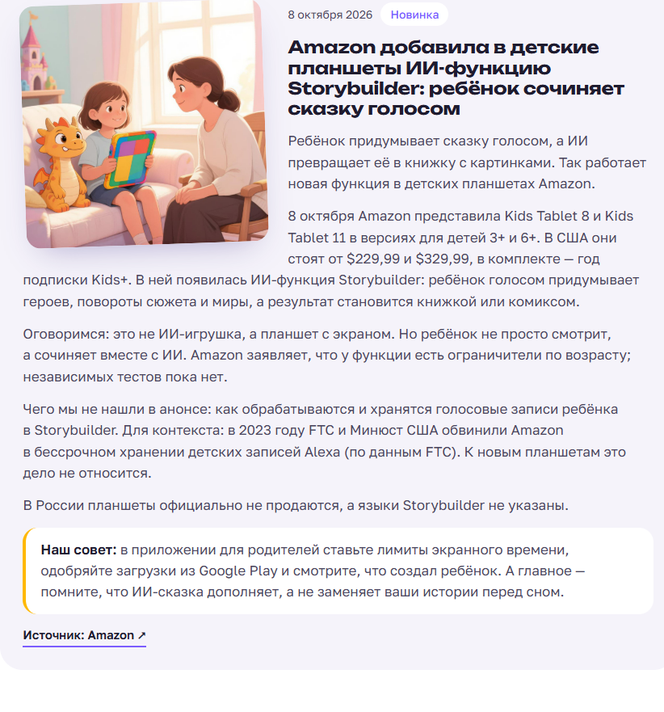
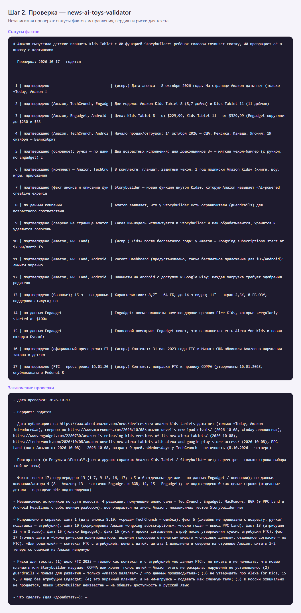
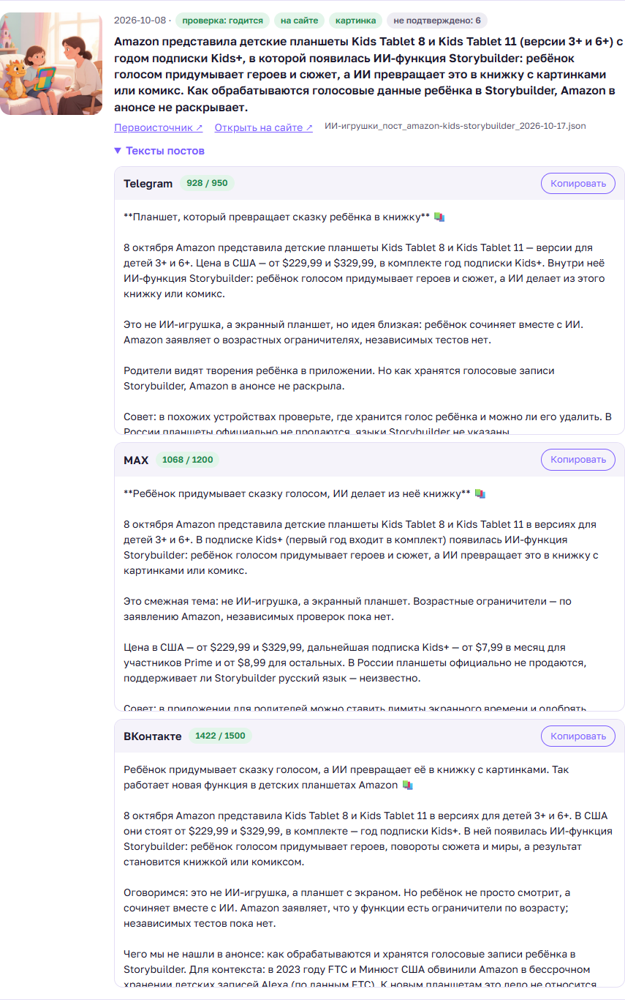
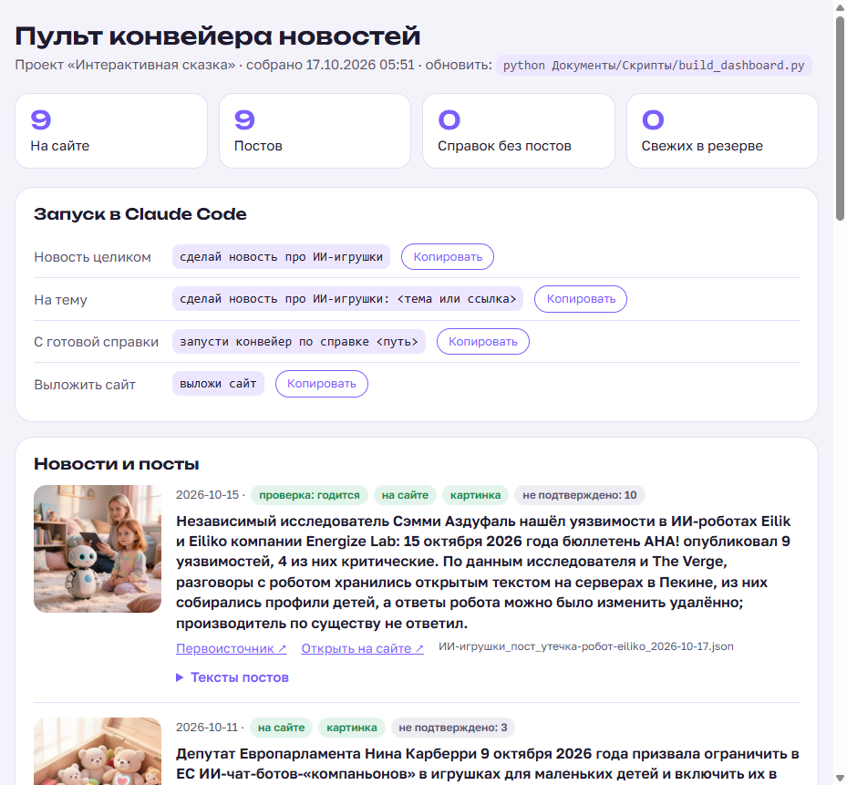

# Конвейер новостей об ИИ-игрушках

> Код и данные проекта — в папке [`Разработка_Игрушка-джойстик/`](Разработка_Игрушка-джойстик/), агенты и скиллы Claude Code — в `.claude/`. Пути в командах ниже даны от папки проекта.

Одна команда в Claude Code — проверенная новость на сайте «Интерактивная сказка» с картинкой и готовыми постами для Telegram, MAX и ВКонтакте.

Подробное описание (проблема, пользователь, MVP, технологии): [`Результат/Конвейер-новостей_описание-проекта_2026-10-17.md`](Разработка_Игрушка-джойстик/Результат/Конвейер-новостей_описание-проекта_2026-10-17.md).
Список всех файлов проекта: [`INDEX.md`](Разработка_Игрушка-джойстик/INDEX.md).

---

## Что делает

Родителям детей 4–10 лет нужны короткие, проверенные новости об ИИ-игрушках: безопасность, приватность, законы, новинки. Вручную одна новость — 40–60 минут; конвейер сокращает ручную часть до двух подтверждений.

```text
«сделай новость про ИИ-игрушки»
   │
 1 Поиск          субагент news-ai-toys-search      → черновик справки + реестр кандидатов
 2 Проверка       субагент news-ai-toys-validator   → статусы фактов, вердикт годится / доработать / отказ
 ✋ Ваше «да» на выбранную новость
 3 Посты          субагент news-ai-toys-content-writer → JSON: Telegram, MAX, ВКонтакте + промпт картинки
 4 Длины          post_check.py                      → Telegram ≤950, MAX ≤1200, ВК ≤1500
 5 Картинка       gigachat_img.py (GigaChat/Kandinsky) → .jpg
 6 Сайт           скилл news-ai-toys-site            → карточка в news.html
 ✋ Скриншот + список файлов, ваше «да» на выкладку
 7 Выкладка       deploy_site.py (SFTP, Рег.ру)      → новость на сайте в интернете
 8 Пульт + коммит   build_dashboard.py                → Результат/Пульт-конвейера.html
```

Всем управляет скилл-оркестратор `news-ai-toys-pipeline`.

## Как это выглядит — демо

Полный прогон оркестратора 17.10.2026 на реальной новости (детские планшеты Amazon с ИИ-функцией Storybuilder). Ручное участие — два ответа «продолжай». Подробно по шагам: [демо-прогон](Разработка_Игрушка-джойстик/Документы/Демо/Конвейер-новостей_демо_2026-10-17.md).

**Результат — карточка на странице «Новости» сайта** (текст, картинка, совет родителям, ссылка на первоисточник):



**Проверка фактов** — отдельный агент перепроверяет каждый факт по 2+ независимым источникам и выносит вердикт:



**Пульт** — тексты постов для Telegram, MAX и ВКонтакте с длиной относительно лимита и кнопкой «Копировать»:



Все шаги прогона:

| # | Шаг | Что получилось | Скриншот |
|---|---|---|---|
| 0 | Старт | Пульт: 9 новостей на сайте | [демо_00](Разработка_Игрушка-джойстик/Документы/Демо/демо_00_пульт-до-прогона.png) |
| 1 | Поиск | Черновик справки: 17 фактов со ссылками; 8 кандидатов в реестре | [демо_01](Разработка_Игрушка-джойстик/Документы/Демо/демо_01_поиск.png) |
| 2 | Проверка | Вердикт «годится»: 13 фактов подтверждено, 4 — «по данным…», 6 исправлено | [демо_02](Разработка_Игрушка-джойстик/Документы/Демо/демо_02_проверка.png) |
| 3 | Посты | JSON для трёх площадок с учётом рисков из проверки | [демо_03](Разработка_Игрушка-джойстик/Документы/Демо/демо_03_посты.png) |
| 4 | Контроль длин | Telegram 928/950, MAX 1068/1200, ВК 1422/1500 | [демо_04](Разработка_Игрушка-джойстик/Документы/Демо/демо_04_контроль-длин.png) |
| 5 | Картинка | GigaChat / Kandinsky, ~1 минута | [демо_05](Разработка_Игрушка-джойстик/Документы/Демо/демо_05_картинка.png) |
| 6 | Сайт | Карточка встала по дате, новостей стало 10 | [демо_06](Разработка_Игрушка-джойстик/Документы/Демо/демо_06_сайт-карточка.png) |
| 7 | Выкладка | Остановка перед загрузкой на хостинг; без «да» ничего не выкладывается | [демо_07](Разработка_Игрушка-джойстик/Документы/Демо/демо_07_выкладка.png) |
| 8 | Пульт после прогона | Новая новость со статусами «годится», «на сайте», «картинка» | [демо_08](Разработка_Игрушка-джойстик/Документы/Демо/демо_08_пульт-после-прогона.png) |
| 9 | Публикация в соцсети | Тексты постов с кнопкой «Копировать» | [демо_09](Разработка_Игрушка-джойстик/Документы/Демо/демо_09_пульт-посты-для-публикации.png) |

## Интерфейс — пульт конвейера



`Результат/Пульт-конвейера.html` — открыть двойным щелчком в браузере. Обновляется оркестратором в конце каждого прогона; вручную:
```
python "D:\myai\Разработка_Игрушка-джойстик\Документы\Скрипты\build_dashboard.py" --open
```

На пульте:
- счётчики: новостей на сайте, постов, справок без постов, свежих кандидатов в резерве;
- команды запуска с кнопкой «Копировать» — вставить в Claude Code;
- лента новостей: картинка, дата, статусы (вердикт проверки, на сайте или нет, картинка, сколько фактов не подтверждено), ссылки на первоисточник и карточку на сайте;
- тексты постов для Telegram, MAX, ВКонтакте с длиной относительно лимита (красным — превышение) и кнопкой «Копировать» — для ручной публикации в соцсетях;
- справки, по которым ещё нет постов, с подсказкой следующего шага; резерв кандидатов ≤14 дней;
- последние записи журналов картинок и выкладки.

## Подготовка (один раз)

1. **Claude Code** открыт в папке `D:\myai`. После добавления новых агентов/скиллов — перезапустить Claude Code.
2. **Python 3** и библиотека для выкладки:
   ```
   python -m pip install paramiko
   ```
   (`gigachat_img.py` и `post_check.py` работают без дополнительных библиотек.)
3. **Доступы** — файл `Документы/Скрипты/.env`:
   - скопировать `Документы/Скрипты/.env.example` → `.env` (в Блокноте: «Сохранить как» → тип «Все файлы», имя `.env`, иначе получится `.env.txt`);
   - хостинг Рег.ру (личный кабинет → услуга хостинга → вкладка «Доступы»): `SFTP_HOST` — **IP-адрес сервера** (не адрес панели), `SFTP_USER`, `SFTP_PASSWORD` (пароль SSH), `SFTP_REMOTE_DIR` (папка сайта, обычно `www/<домен>`), `SITE_URL`;
   - GigaChat (кабинет developers.sber.ru): `GIGACHAT_AUTH_KEY`, `GIGACHAT_SCOPE` (физлицо — `GIGACHAT_API_PERS`).

   `.env` в git не попадает. Ключи в чат не присылать.
4. **Проверка доступов** (в обычном окне PowerShell):
   ```
   python "D:\myai\Разработка_Игрушка-джойстик\Документы\Скрипты\gigachat_img.py" --check
   python "D:\myai\Разработка_Игрушка-джойстик\Документы\Скрипты\deploy_site.py" --check
   ```
   При первом подключении к хостингу скрипт покажет отпечаток ключа сервера — после сверки повторить с `--trust-new-host`.
   **VPN (hidemyVPN) перед выкладкой отключить** — с ним соединения вне браузера зависают.

## Запуск

Написать в Claude Code:

| Что нужно | Команда |
|---|---|
| Новость от поиска до сайта | `сделай новость про ИИ-игрушки` |
| Новость на заданную тему / по ссылке | `сделай новость про ИИ-игрушки: <тема или ссылка>` |
| Без первой остановки | `сделай новость про ИИ-игрушки, без остановок до сайта` (перед выкладкой всё равно спросит) |
| Продолжить с готовой справки | `запусти конвейер по справке <путь>` |
| Продолжить с готового поста | `запусти конвейер с поста <путь к JSON>` |
| Только выложить сайт | `выложи сайт` |

Отдельные шаги можно запускать и по одному: «найди новость» (`news-ai-toys-search`), «проверь справку <путь>» (`news-ai-toys-validator`), «напиши посты по справке <путь>», «добавь новость на сайт <путь к JSON>».

Скрипты вручную (PowerShell, из `D:\myai\Разработка_Игрушка-джойстик\Документы\Скрипты\`):
```
python build_dashboard.py --open         собрать и открыть пульт
python post_check.py <JSON поста>        проверить длины и хэштеги
python gigachat_img.py <JSON поста>      нарисовать картинку
python deploy_site.py                    показать, что будет выложено
python deploy_site.py --upload           выложить (спросит «да»)
```

## Пользовательский сценарий

Пример одного прогона — что видит Иван и что от него требуется.

1. **Иван:** «сделай новость про ИИ-игрушки».
2. **Агент ищет** (≈5–10 мин): три волны поиска на русском и английском, 5–8 кандидатов, свежесть ≤14 дней по дате первоисточника. Все кандидаты — в реестр, лучшие непрошедшие — в «резерв» на следующие разы.
   *Нет свежего* → агент показывает таблицу кандидатов и ждёт решения.
3. **Агент проверяет** (≈5 мин): каждый факт по 2+ независимым источникам, цитаты, ссылки, юридические риски. Пересказы одной статьи — один источник.
   *Вердикт «отказ»* → агент предлагает повторить поиск.
4. **✋ Остановка №1.** Агент показывает: заголовок, дату, суть, «подтверждено 6 / по данным… 6 / не подтверждено 2», риски.
   **Иван:** «да» (или «возьми другую»).
5. **Агент готовит** (≈3–5 мин): посты, проверка длин (если Telegram длиннее 950 — возвращает на сокращение), картинка, карточка на странице «Новости».
6. **✋ Остановка №2.** Агент показывает скриншот карточки и список файлов к выкладке.
   **Иван:** читает карточку, «да».
7. **Агент выкладывает** сайт и даёт ссылку на новость, делает коммит.
8. **Итог:** таблица по шагам и обновлённый пульт. Ивану остаётся открыть `Пульт-конвейера.html` и опубликовать посты в соцсетях кнопкой «Копировать» (автопостинг — в планах).

Ручное время Ивана: два ответа «да» и вычитка карточки — до 10 минут.

## Что получается на выходе

| Файл | Где |
|---|---|
| Справка с проверкой фактов | `Документы/Новости/ИИ-игрушки_новость_<тема>_<дата>.md` |
| Реестр всех кандидатов | `Документы/Новости/ИИ-игрушки_кандидаты_реестр.md` |
| Посты (JSON, схема `ai-toys-post/v1`) | `Результат/Посты/ИИ-игрушки_пост_<тема>_<дата>.json` |
| Картинка | `Результат/Посты/ИИ-игрушки_пост_<тема>_<дата>.jpg` |
| Страница новостей | `Результат/Сайт/news.html` (картинки — `assets/img/news/`) |
| Журналы | `Документы/Скрипты/журнал_картинок.csv`, `журнал_выкладки.csv` |
| Пульт (интерфейс) | `Результат/Пульт-конвейера.html` |

## Если что-то не работает

| Симптом | Что делать |
|---|---|
| Новый агент/скилл «не найден» | Перезапустить Claude Code |
| `Нет файла …\.env` | Файл сохранился как `.env.txt` — переименовать |
| `Error reading SSH protocol banner` | Отключить VPN, проверить `curl.exe -I https://ya.ru`; дальше — раздел «Проверка доступа на хостинг» в [инструкции тестирования](Разработка_Игрушка-джойстик/Документы/Конвейер-новостей_инструкция-тестирования_2026-10-17.md) |
| `Authentication failed` | Сверить пароль SSH; не повторять больше раза — Рег.ру блокирует SSH на ~2 часа |
| Картинка не генерируется | `gigachat_img.py --check`: ключ, scope, сертификат `certs/russian_trusted_root_ca.pem` |
| Пост длиннее лимита | Оркестратор сам вернёт на сокращение; вручную — `post_check.py` покажет, на сколько |

## Состав

| Компонент | Файл |
|---|---|
| Оркестратор | `D:\myai\.claude\skills\news-ai-toys-pipeline\SKILL.md` |
| Поиск | `D:\myai\.claude\agents\news-ai-toys-search.md` |
| Проверка | `D:\myai\.claude\agents\news-ai-toys-validator.md` |
| Посты | `D:\myai\.claude\agents\news-ai-toys-content-writer.md` (и скилл `news-ai-toys-post`) |
| Сайт | `D:\myai\.claude\skills\news-ai-toys-site\SKILL.md` |
| Скрипты | `Документы/Скрипты/post_check.py`, `gigachat_img.py`, `deploy_site.py`, `build_dashboard.py` |
| Тестирование | `Документы/Конвейер-новостей_инструкция-тестирования_2026-10-17.md` |
| Скилл проекта (структура, проверка, экспорт) | `D:\myai\.claude\skills\news-ai-toys-project\SKILL.md` |

## Проверка и передача коллегам

Скилл `news-ai-toys-project` помогает Claude Code работать с этим репозиторием: знает структуру и форматы данных, правила правок, обновляет README, проверяет ошибки и собирает комплект для коллег.

| Задача | Сказать в Claude Code или выполнить |
|---|---|
| Проверить проект на ошибки | «проверь проект» или `python "D:\myai\.claude\skills\news-ai-toys-project\scripts\project_check.py"` |
| Собрать комплект для коллеги | «подготовь проект к передаче» или `python "D:\myai\.claude\skills\news-ai-toys-project\scripts\export_project.py" --root "<путь у коллеги>" --zip` |
| Развернуть у себя (коллега) | распаковать комплект, открыть Claude Code в папке, сказать «разверни проект по скиллу news-ai-toys-project» |

Комплект собирается в `tmp/export/` (в git не попадает): проект без `.env`, ключей, личных и рабочих документов, плюс агенты, скиллы, `.gitignore` и корневой `README.md` с разделом «Развернуть у себя».

## Ограничения и планы

- Посты в соцсети публикуются вручную; автопостинг (Telegram Bot API, VK API, MAX) — после создания каналов.
- Запуск по расписанию (2 раза в неделю, Cron) — в планах.

---

## Развернуть у себя

Комплект собран 2026-10-17 из рабочего репозитория проекта «Интерактивная сказка».

### Что внутри
- `Разработка_Игрушка-джойстик/` — проект: README (начните с него), скрипты, справки, посты, сайт, пульт.
- `.claude/agents/` — субагенты: поиск, проверка, посты.
- `.claude/skills/` — скиллы: оркестратор `news-ai-toys-pipeline`, сайт, посты и `news-ai-toys-project` — скилл работы с этим репозиторием.

### Как развернуть
1. Склонируйте репозиторий или скопируйте папку целиком.
2. Откройте в ней Claude Code и скажите: **«разверни проект по скиллу news-ai-toys-project»** — Claude проверит Python, поставит зависимости, поможет заполнить `.env` и прогонит проверку.
3. Вручную то же самое — раздел «Подготовка» в `Разработка_Игрушка-джойстик/README.md`.

⚠ Инструкции агентов и скиллов ссылаются на `D:\myai`. Либо положите комплект в `D:\myai`, либо попросите Claude: «замени D:\myai на путь к этой папке во всех файлах .claude и README» (или пересоберите комплект с --root).

### Чего здесь нет (специально)
- `.env` с доступами и ключами — у каждого свои (образец: `Разработка_Игрушка-джойстик/Документы/Скрипты/.env.example`).
- Личные и рабочие документы владельца проекта, ТЗ и исходные иллюстрации.
